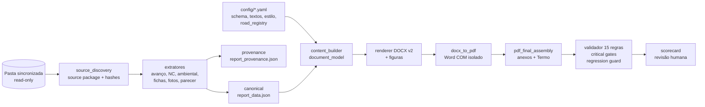

# Relatório Semanal Automatizado

> **Summary in English.** Reverse engineering and automation of the *Weekly Construction
> Monitoring Report* of a road-infrastructure program (four highway works). The project first
> mapped, from the existing documents only, how ~190 weekly reports had been produced by hand
> (data lineage, rules, inherited errors), then built a generator that rebuilds a week's report
> from its sources: a canonical data model with per-field provenance, a DOCX renderer, automated
> DOCX→PDF via isolated Word COM, final PDF assembly with annexes, a 15-rule validator, critical
> gates and a regression guard against the human-made "golden" report. AI is optional and
> grounding-only: it never invents facts, dates, places or numbers. Sanitized public version —
> client identifiers replaced, real data removed.

Autora: **Emmily Maciel** ([@Emmilymaciell](https://github.com/Emmilymaciell))

---

## Problema

O relatório semanal de acompanhamento de obras de um contrato de infraestrutura rodoviária
era produzido **à mão, por cópia**: o `.docx` de cada semana era o da semana anterior salvo com
outro nome, com figuras coladas como imagem (EMF) a partir de várias planilhas, para quatro
obras, toda semana. Não existia template, nem registro de onde vinha cada número — e erros
de uma semana eram herdados pelas seguintes.

## Solução

Duas fases, nesta ordem obrigatória: `ANALISAR → MAPEAR → VALIDAR → AUTOMATIZAR`.

1. **Engenharia reversa (descoberta).** Scripts numerados (`scripts/01_…` a `25_…`) inventariam
   o acervo, extraem a estrutura interna dos PDF/DOCX/XLSX, comparam versões e reconstroem a
   linhagem de cada campo. Toda afirmação recebe um nível de confiança
   (`CONFIRMADO`, `ALTA CONFIANÇA`, `PROVÁVEL`, `HIPÓTESE`, `DESCONHECIDO`).
2. **Gerador (`scripts/gerador/`).** Monta o relatório de uma obra/semana a partir das fontes:
   - *source discovery* → *source package* com hash de cada arquivo-fonte;
   - modelo canônico (`report_data.json`) + **proveniência por campo** (`report_provenance.json`);
   - renderer DOCX guiado por configuração (`config/*.yaml`: estrutura, textos, estilo);
   - DOCX→PDF automático via Word COM isolado (cópia, subprocesso, timeout, lock) — `DEC-006`;
   - montagem do PDF final (anexos + Termo de Encerramento);
   - validador de 15 regras, critical gates e *regression guard* contra a versão anterior.

Princípios de projeto (das decisões registradas): **padronizar forma, nunca fato**;
**não reproduzir erros herdados**; a estrutura do relatório é **configuração, não código**
(`DEC-002`); ordem de preferência das fontes `DET → VAL → TPL → IA grounded → HITL → MAN`;
dado cujo valor histórico não pode ser reconstruído vira `LIMITATION` declarada (`DEC-005`).

## Arquitetura



- `scripts/prog_util.py` — utilitários comuns: caminhos longos (`\\?\`), cópia segura para
  `tmp/`, `assert_read_only()` que impede qualquer escrita na pasta de origem.
- `scripts/generate.py` — comando único (ver `docs/COMO_GERAR.md`).
- `scripts/validar_relatorio_semanal.py` — validador do corpus.
- `docs/decisoes/` — DEC-001 a DEC-006. `docs/arquitetura/` — specs das fatias do gerador.

## Números

Fonte: `STATE.md` do projeto original (estado técnico de 2026-10-07) e
`docs/RELATORIO_ENGENHARIA_REVERSA.md`.

| Métrica | Valor |
|---|---|
| Pastas-semana inventariadas (4 obras) | 193 |
| Arquivos do ecossistema documental inventariados | 3.944 |
| Relatórios validados pelo validador (15 regras) | 177 |
| Validador no modelo vigente (v3) | 298 PASS · 0 FAIL |
| Candidate v0.3 (obra RD-103) | 15/15 regras PASS · 12/12 critical gates · 0 SHADOW_ERROR |
| Convergência do gerado com o relatório humano (v0.1 → v0.3) | 42,6 % → 59,6 % |
| Conteúdo que exige IA obrigatoriamente | 0 % (69,8 % fixo, 22,3 % template) |
| Arquivos de teste | 29 |
| Tempo economizado por semana | [a confirmar pela autora] |

Situação no projeto original: reta final para "MVP pronto para uso em sombra"; checkpoints A e B
concluídos, rodada multiobra C pendente de regeneração.

## Como rodar

Requisitos: Windows 11, Python 3.12, `python -m pip install -r requirements.txt`;
Microsoft Word apenas para a etapa DOCX→PDF.

```bash
# testes que não dependem do acervo real (configuração + fixtures sintéticas em tempdir);
# não reexecutados na preparação desta versão pública — ver RELATORIO de sanitização
python tests/test_config_integridade.py
python tests/test_gates_genericos.py
python tests/test_multiobra_r1.py
python tests/test_docx_to_pdf.py        # exige Word
```

Os testes que leem o acervo real (SharePoint de origem, `output/shadow/`, inventários)
**são pulados** nesta versão com a mensagem
`SKIP …: depende de dado real do contrato — removido na versão pública`
(guarda em `tests/_dados_reais.py`). O gerador completo (`scripts/generate.py`) precisa de uma
pasta de origem com a estrutura descrita em `config/source_layout.yaml`; os dados do contrato
não acompanham este repositório.

## O que eu decidi × o que a IA gerou

- **Decisões da autora** (registradas em `docs/decisoes/` e no `CLAUDE.md`): a ordem
  analisar → mapear → validar → automatizar e a proibição de construir o gerador antes da
  revisão da descoberta; a pasta de origem *read-only* absoluta; a estratégia híbrida de imagens
  (`DEC-003`); o modelo vigente como única autoridade (`DEC-002`); o modo de geração histórica
  com `LIMITATION` declarada (`DEC-005`); IA apenas *grounded* e opcional; ENGINE FREEZE
  (diferença entre obras só por configuração); as respostas às perguntas abertas da descoberta.
- **Gerado com Claude Code sob revisão da autora**: os scripts de investigação, o pacote
  `gerador/`, os testes e a documentação viva, em sessões guiadas por `CLAUDE.md` e pelas
  skills `session-start`/`session-close`. Proporção exata código manual × gerado:
  [a confirmar pela autora].

## Stack

Python 3.12 · python-docx · PyMuPDF · openpyxl · PyYAML · Pillow · reportlab · lxml ·
pywin32 (Word COM) · Claude Code.

---

> **Dados fictícios.** Versão sanitizada de um sistema em uso real; identificadores do cliente
> foram substituídos (rodovias `RD-1xx/RD-2xx`, empresas `Executora A–D`, supervisoras,
> pessoas `Pessoa A…`, municípios, números de contrato e de licença). Inventários, relatórios
> gerados, evidências e logotipos reais foram removidos.
